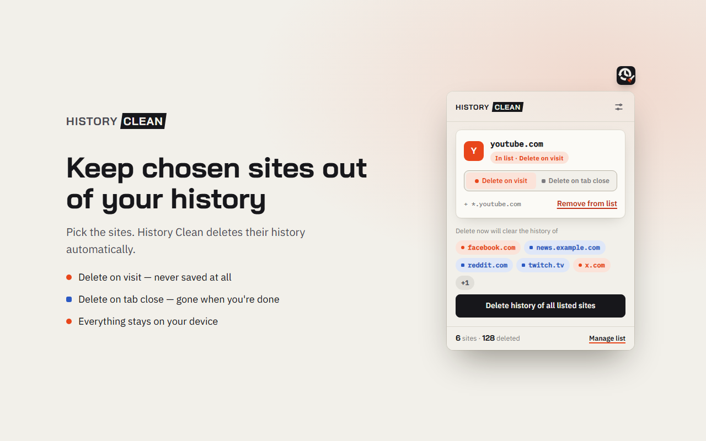

# History Clean

A small Edge extension that keeps the sites you pick out of your browsing history.

It started with a small annoyance: every time I logged in to a site I didn't want in my history, I had to go back and delete the entries one by one afterwards. I didn't want to use InPrivate or wipe everything either. So now you add a site once, choose when its history should go, and History Clean handles the rest.

(It was called TabSweep up to version 1.2.0.)



## What it does

Each site in your list gets one of two modes:

- **Delete on visit** removes every page from history right after you open it. It also re-checks when you close the tab, every few minutes (5 by default), and when the browser starts, in case something slipped through.
- **Delete on tab close** leaves history alone while you're using the site, then wipes it when you close the last tab of that site. If you close the whole browser at once, it cleans up on the next start.

Adding `youtube.com` also covers `m.youtube.com`, `music.youtube.com` and so on, but not look-alikes like `notyoutube.com`. Shared zones like `co.th` or `co.uk` are rejected on purpose, since they'd wipe history for thousands of unrelated sites.

Other bits:

- A **Delete now** button that shows exactly which sites it's about to clean, then tells you how many entries were removed per site.
- An optional count on the toolbar icon (items deleted since the browser started).
- An optional popup that drops down from the icon after a cleanup and closes itself after 4 seconds.
- **Hide site names**: the list, the popup and the cleanup popup show `••••••` instead of the names, for when someone's looking at your screen. Click the eye icon to peek; it hides again when you close the page. This only masks the screen, the list itself is still stored as plain text in extension storage.
- English and Thai UI. It follows your browser language by default, and you can switch it in Settings.
- Light and dark themes.

## Privacy

Everything runs on your machine. There are no servers, no analytics and no network requests. Your site list stays in local extension storage and isn't synced anywhere. History Clean only touches browsing history, so cookies, cache and saved passwords are left alone.

Full policy: https://fzerog.github.io/tabsweep/privacy.html

## Install

Get it from the [Microsoft Edge Add-ons store](https://microsoftedge.microsoft.com/addons/detail/apiadgefflpmneegaogmjepgfccepagd).

Or load it from source:

1. Clone or download this repo.
2. Open `edge://extensions` and turn on **Developer mode** (bottom left).
3. Click **Load unpacked** and pick the repo folder.
4. Optional: pin it from the puzzle-piece menu so the icon stays on the toolbar.

It should also work in Chrome 127+, since it only uses standard extension APIs, but I've only tested it in Edge.

## Known limitations

- If you close the entire browser in one go, the "on tab close" cleanup may not finish before Edge shuts down. It catches up on the next launch.
- Navigating away from a site inside the same tab doesn't count as closing it. The cleanup happens when that tab is closed.
- I haven't confirmed whether deletions propagate through Edge Sync to your other devices.
- The auto popup only opens while the Edge window is focused, and it briefly takes keyboard focus while it's open.
- History kept by online accounts (Google My Activity, your Microsoft account) is separate and has to be managed there.

## Development

There's no build step for the extension itself. Edit the files, then hit **Reload** on the History Clean card in `edge://extensions`. Logs from the background worker are prefixed with `[HistoryClean]` (Inspect views → service worker).

Project layout:

```
background.js      service worker: visit/tab tracking, sweeps, badge, popup trigger
popup.*, options.* the two UI pages
lib/sites.js       domain matching and history sweeping
lib/i18n.js        translations (loads _locales/<lang>/messages.json)
lib/ui.js          small DOM helpers shared by both pages
_locales/          en and th strings
fonts/             bundled fonts (SIL OFL 1.1, licenses included)
icons/             toolbar icons
docs/              GitHub Pages site (privacy policy)
store/             store listing text, logo and screenshots
tools/             helper scripts (not shipped)
```

Helper scripts (Python 3, standard library only):

- `python -I tools/build_zip.py` packages the extension into `dist/tabsweep-<version>.zip`. It refuses to build if a string is missing from either language or a referenced file doesn't exist.
- `python -I tools/make_icons.py icons` regenerates the toolbar icons, and `... store` the 300×300 store logo.
- `python -I tools/fetch_fonts.py fonts` re-downloads the fonts from Google Fonts.

When adding UI text, put the string in both `_locales/en/messages.json` and `_locales/th/messages.json`. HTML uses `data-i18n="key"` (or `data-i18n-attr="placeholder:key"`) and JS uses `t("key", ...)`.

## Permissions

| Permission | Why |
|---|---|
| `history` | Find and delete history entries for the sites in your list |
| `tabs` | Know when the last tab of a listed site closes, and show the current site in the popup |
| `storage` | Save your site list and settings locally |
| `alarms` | Run the periodic re-check |

## Credits

Fonts: [Bai Jamjuree](https://fonts.google.com/specimen/Bai+Jamjuree), [Anuphan](https://fonts.google.com/specimen/Anuphan) and [IBM Plex Mono](https://fonts.google.com/specimen/IBM+Plex+Mono), all under the SIL Open Font License.

Found a bug or have an idea? [Open an issue](https://github.com/FZeroG/tabsweep/issues).
